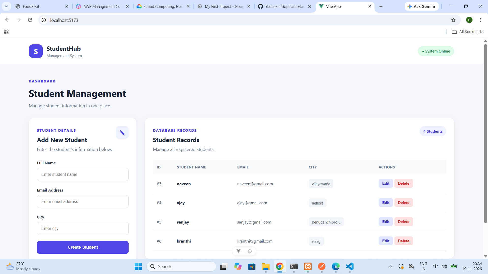
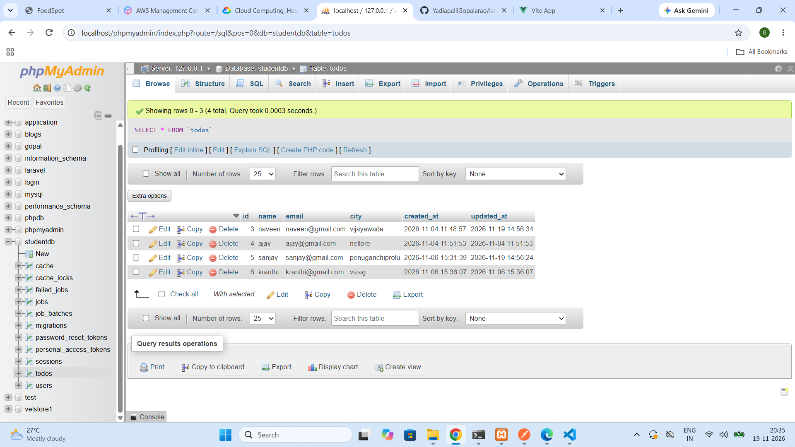
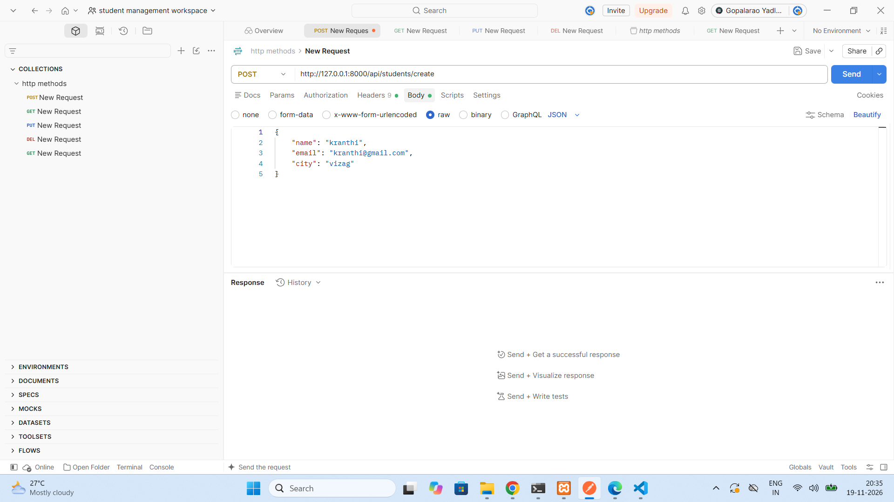
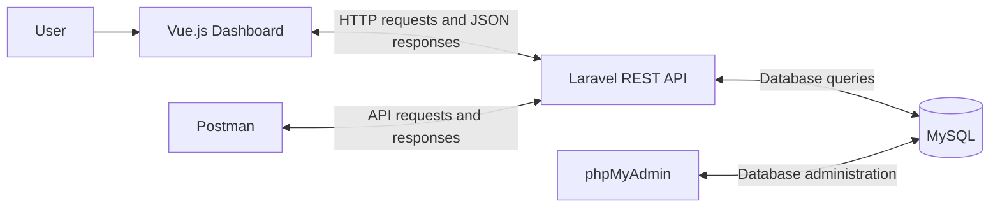

# StudentHub — Student Management System

A full-stack student management web application built with **Vue.js, Laravel and MySQL**. StudentHub provides a centralized dashboard for managing student information through REST API-based CRUD operations.


## Project Overview

StudentHub simplifies student record management by connecting a Vue.js frontend to a Laravel REST API and a relational database. Users can add student details, view registered students, update existing records and delete records from a single dashboard.

The project demonstrates full-stack development, frontend-to-backend integration, RESTful HTTP operations and persistent database storage in a local development environment.

## Features

- **Create:** Add a student using their full name, email address and city.
- **Read:** Display registered students in a tabular dashboard.
- **Update:** Edit existing student information.
- **Delete:** Remove student records.
- Display the total number of registered students.
- Exchange JSON data between the frontend and backend.
- Store student information in a relational database.
- Prepare and test API requests using Postman.

## Application Screenshots

### Student Management Dashboard

The Vue.js interface provides a student registration form, student records table and edit/delete actions.



### Database Records — phpMyAdmin

Student records are stored in the `todos` table of the `studentdb` database. The displayed database records correspond to those in the dashboard.



### REST API — Postman

Example POST request for creating a student using a JSON request body.



## Technology Stack

| Layer | Technology | Purpose |
| --- | --- | --- |
| Frontend | Vue.js | User interface and student record management |
| Build tool | Vite | Frontend development server and build process |
| Backend | Laravel / PHP | REST API and application logic |
| Database | MySQL-compatible database | Persistent student records |
| Database administration | phpMyAdmin | Inspect and manage database records |
| API testing | Postman | Prepare and test HTTP requests |
| Data format | JSON | Frontend and backend communication |

## Application Architecture



The application separates the presentation layer, application logic and data storage. The frontend runs on Vite during local development, while Laravel handles API requests and communicates with the database.

## Request and Data Flow

1. A user opens the StudentHub dashboard at `http://localhost:5173`.
2. The user enters student details or selects an existing record to edit or delete.
3. Vue.js sends an HTTP request to the Laravel backend at `http://127.0.0.1:8000`.
4. Laravel processes the request and performs the corresponding database operation.
5. The backend returns a response to the frontend.
6. The dashboard displays the resulting student records.

## REST API

Base URL for local development:

```text
http://127.0.0.1:8000/api
```

| HTTP Method | Operation | Endpoint |
| --- | --- | --- |
| `POST` | Create a student | `/api/students/create` |
| `GET` | Retrieve student records | See registered Laravel routes |
| `PUT` | Update a student | See registered Laravel routes |
| `DELETE` | Delete a student | See registered Laravel routes |

The create endpoint is shown in the supplied Postman screenshot. The exact paths of the remaining requests are not shown; use Laravel's route listing from the backend directory to confirm them:

```bash
php artisan route:list --path=api
```

### Example: Create a Student

**Method:** `POST`

**URL:** `http://127.0.0.1:8000/api/students/create`

**Headers:** `Content-Type: application/json` and `Accept: application/json`

**Request body:**

```json
{
  "name": "Example Student",
  "email": "student@example.com",
  "city": "Vijayawada"
}
```

The example uses synthetic student details. Response fields and status codes depend on the actual Laravel controller implementation.

## Database Design

- **Database:** `studentdb`
- **Table:** `todos`

| Column | Purpose |
| --- | --- |
| `id` | Student record identifier |
| `name` | Student name |
| `email` | Student email address |
| `city` | Student city |
| `created_at` | Record creation timestamp |
| `updated_at` | Record modification timestamp |

The column names are based on the database screenshot. Field types, constraints and indexes should be checked against the Laravel migrations or actual database schema.

## Getting Started

### Prerequisites

- PHP and Composer compatible with the project's Laravel version
- Node.js and npm compatible with the project's frontend dependencies
- A running MySQL-compatible database server
- Git
- Postman and phpMyAdmin (optional, for API and database inspection)

### 1. Clone the repository

```bash
git clone <your-github-repository-url>
cd <repository-folder>
```

### 2. Set up the Laravel backend

Open the folder containing the Laravel `artisan` and `composer.json` files and run:

```bash
composer install
cp .env.example .env
php artisan key:generate
```

On Windows Command Prompt, use `copy .env.example .env` instead of `cp`. Do not overwrite an existing `.env` file.

Create a local database named `studentdb`, then configure the backend `.env` file using your database credentials:

```dotenv
APP_URL=http://127.0.0.1:8000
DB_CONNECTION=mysql
DB_HOST=127.0.0.1
DB_PORT=3306
DB_DATABASE=studentdb
DB_USERNAME=your_database_username
DB_PASSWORD=your_database_password
```

If the project includes migrations for the required tables, run them against your new local database:

```bash
php artisan migrate
php artisan serve
```

The Laravel development server should be available at `http://127.0.0.1:8000`.

### 3. Set up the Vue.js frontend

In a separate terminal, open the frontend folder containing `package.json`:

```bash
npm install
npm run dev
```

Open `http://localhost:5173` in the browser. Ensure the frontend's API configuration points to the local Laravel server and that the backend permits requests from the frontend origin if needed.

These are standard local setup steps; use the actual folder names, dependency versions, environment variables and migrations in the repository.

## API Testing

Postman can be used to exercise the CRUD workflow independently of the frontend:

1. Send a POST request to create a new student.
2. Send a GET request using the registered route to retrieve student records.
3. Send a PUT request to update an existing record.
4. Send a DELETE request to remove a record.
5. Verify the resulting database changes and dashboard behavior.

## Key Learning Outcomes

- Building a full-stack application using Vue.js and Laravel.
- Designing and integrating REST APIs using HTTP methods.
- Implementing Create, Read, Update and Delete (CRUD) operations.
- Working with relational databases and persistent records.
- Using JSON for client-server communication.
- Inspecting and testing APIs with Postman.
- Separating frontend, backend and database responsibilities.

## Future Enhancements

Potential extensions include student search, pagination, authentication, role-based authorization, automated tests and cloud deployment.

## Project Status

Local development project. The screenshots demonstrate the running dashboard, database records and a configured Postman request. Cloud deployment and automated CI/CD are not represented in these screenshots.
